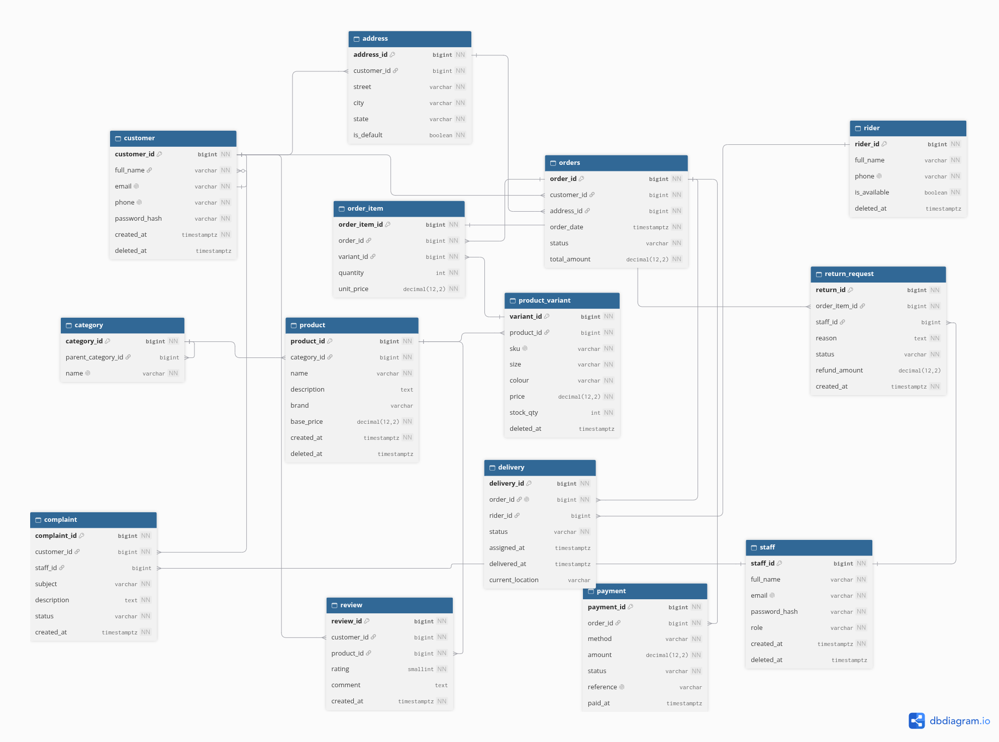

# Portfolio 1: Database Design and Modelling

**MIT 8103 Advanced Database Systems**
Anthony Gotar

---

## 1. Case Study: ThreadHaus

ThreadHaus is a simulated online clothing store. The scenario models a retail business that sells clothing products in multiple sizes and colours through a web platform. Customers browse a product catalogue, place orders, and pay online or on delivery. The store manages its own inventory, dispatches riders for last-mile delivery, and has internal staff who handle operations and customer support.

**Users of the database:**

- Customers — register, log in, browse products, place orders, make payments, request returns, submit complaints, and write reviews.
- Admins and store managers — manage products, categories, stock, and generate sales reports.
- Delivery riders — are assigned to orders and update delivery status.
- Customer support staff — handle complaints and process return requests.

**Major data stored:**

Customer accounts and delivery addresses; product catalogue organised by category, with variants for each size and colour combination; orders and their line items; payments against orders; delivery assignments and tracking; return requests; complaints; and product reviews.

**Key operations:**

Register and log in; manage products and variants; search the catalogue; place an order and update stock; process payment; assign a rider and track delivery; handle returns and refunds; post reviews; generate sales reports.

---

## 2. Files in This Folder

| File | What it is |
|---|---|
| `schema.sql` | DDL script that creates all 14 tables with constraints and foreign keys. Re-runnable. |
| `sample-data.sql` | INSERT statements loading realistic sample rows (Nigerian names, naira prices). Needs a fresh database. |
| `checks.sql` | Three verification queries: row counts, order totals vs item sums, orders overview join. |
| `constraint-tests.sql` | Five statements that must fail, one per constraint type. Run without ON_ERROR_STOP. |
| `er-diagram.md` | ER diagram in Mermaid format. Renders on GitHub. |
| `evidence/` | Folder of text output files and screenshots from running the scripts. |

---

## 3. ER Diagram

The diagram is in `er-diagram.md` and renders directly on GitHub. An exported image is below.

**Note on delivery.order_id:** In the Mermaid diagram, `delivery.order_id` is marked only `FK`. Mermaid rejects the combination `FK UK` and throws a parse error. In `schema.sql` the column has `UNIQUE (order_id)`, so an order has at most one delivery. The one-to-zero-or-one cardinality on the relationship line (`||--o|`) also reflects this.

